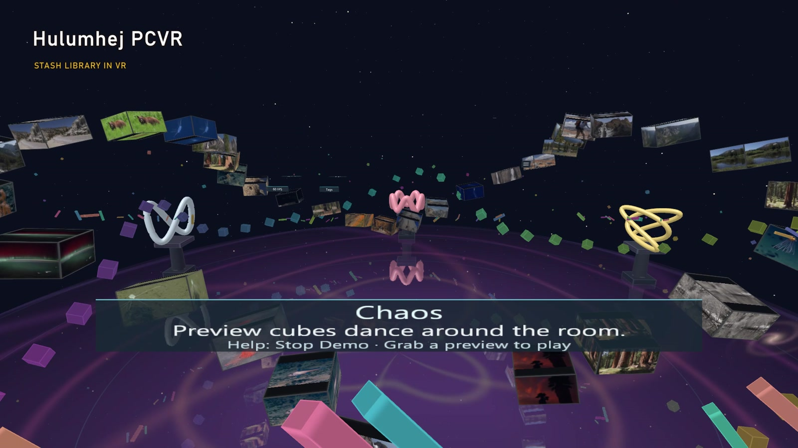
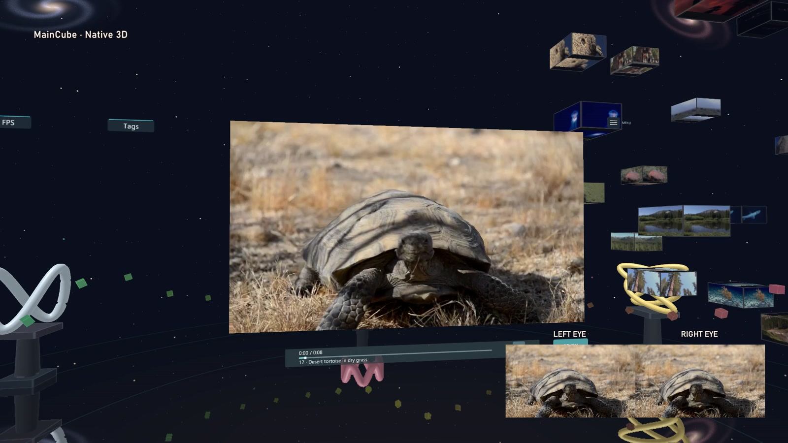

# Hulumhej PCVR

Hulumhej is a Windows VR player for Stash. It runs on the PC and streams to Steam Frame through SteamVR. Connect it to your existing Stash server, browse animated previews in VR, and play a clip on MainCube.

**[Watch the 90-second demo](https://github.com/mikkelstorkholm-ux/hulumhej-pcvr-alpha/releases/download/v0.1.0-alpha.1/Hulumhej-Stash-Demo-1080p60.mp4)** · **[Alpha downloads](https://github.com/mikkelstorkholm-ux/hulumhej-pcvr-alpha/releases)** · **[Report an issue](https://github.com/mikkelstorkholm-ux/hulumhej-pcvr-alpha/issues/new)**

## What you can try

- Grab and scrub a preview, then play the full clip on MainCube.
- Browse animated preview layouts and find scenes by title, tags, or models.
- Play regular 2D videos with built-in stereoscopic depth or use your existing FlatVR installation.
- Adjust preview count and animation speed. The in-room FPS panel shows rendering and playback performance.

## Getting started

Use Windows x64 with OpenGL 4.5, SteamVR as your OpenXR runtime, a connected headset, and a reachable Stash server. Steam Frame and an RTX 4080 are the reference setup. Other headset and GPU combinations are welcome in the alpha.

1. Extract the Windows alpha ZIP into a folder you can write to. Keep its files together.
2. Open `library.json` and set `url` to your Stash server's address. Start with a test library if you prefer.
3. Connect the headset, start SteamVR, and double-click **Start HH.cmd**. Select Hulumhej in your headset.

**Native 3D is selected on startup in the Native 3D package.** In the MainCube menu, open **3D** to choose **2D**, **Native 3D**, or **FlatVR**. FlatVR uses a separate installation and its virtual display. If automatic activation needs help, Hulumhej asks you to click **START** in FlatVR.

To check the portable launcher in Windows Sandbox, run `& '.\Start HH.cmd' -CheckOnly` from a writable copy in PowerShell. Test headset playback and the 3D controls on your regular Windows PC.

## Alpha feedback

This is a free alpha. The application source is currently private. This repository hosts releases and feedback.

Please include your **build ID, headset, GPU, and playback mode** when reporting an issue. Setup, seeking, 3D quality, and smoothness are especially useful to hear about. The launcher prints the log folder as `HH_LOG_DIR`. Remove private server addresses, media titles, and credentials from anything you share.

The demo uses nature and space footage from a separate test library. [Demo credits](DEMO-CREDITS.md)
